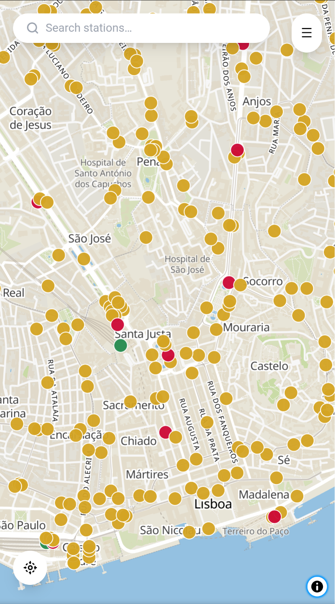
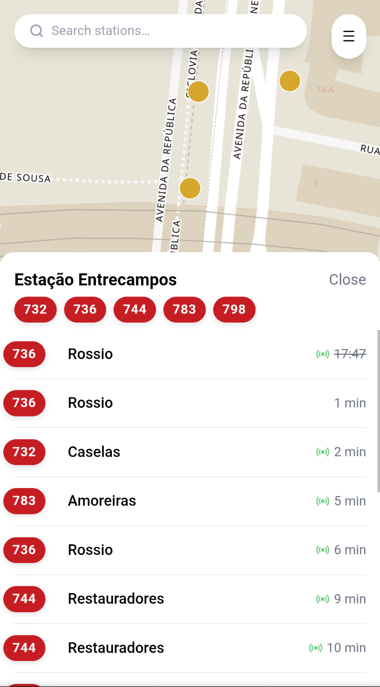
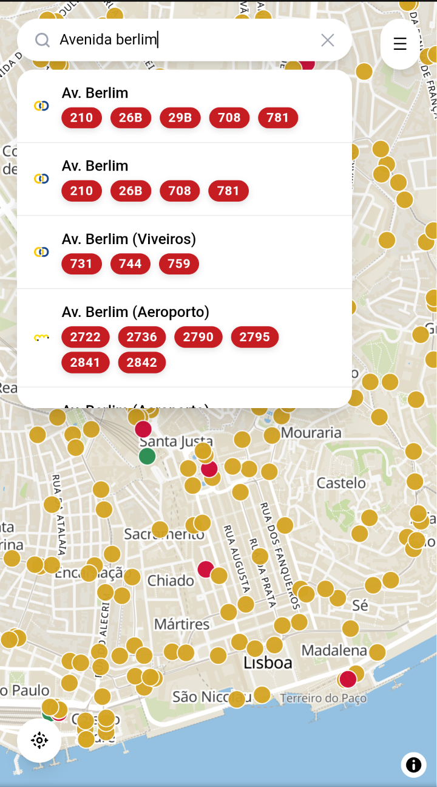

# PTRANSIT 🚌🚇


| Map view on start | Search for stops | Depatures for a stop |
|-------|----|-----|
| | |  |


<!-- <p align="center">
  
  
  
</p>

<p align="center">
  <em>Map view on start · Search for stops · Departures for a stop</em>
</p> -->

<p align="center">
  <a href="#self-hosted-deployment">Self-hosted deployment</a> · <a href="#currently-supported-operators">Currently supported operators</a> · <a href="#roadmap">Roadmap</a> · <a href="#disclaimer">Disclaimer</a>
</p>

This project aims to provide schedules and real-time updates for most public transit modes in the Lisbon metropolitan area (list of supported operators available [here](#currently-supported-operators)).

<!-- While most operators provide information about schedules, stops and lines using the widely adopted [GTFS](https://gtfs.org/) standard, only some provide real-time updates using [GTFS Realtime](https://gtfs.org/documentation/realtime/reference/) (Carris Metropolitana and Carris)

The remainder operators either use internally designed APIs (Metro de Lisboa, CP) or provide no real-time information at all (Fertagus and Metro Sul do Tejo) -->


The project is made up of:
- A unified API that provides schedules and real-time updates for most public transit modes in the Lisbon metropolitan area. Built using TypeScript, Node.js and Express. 
- A web application centred around a map view that allows users to view schedules and real-time updates for public transit in Lisbon. Built using React, TypeScript and maplibre
- A tile server (maptiler) that provides the map tiles used in the web application. 
- A PostgreSQL database instance that stores the static GTFS data (stops, lines, schedules, etc.) from the operators
- A database population script that downloads the GTFS data from the operators, parses it, corrects it and populates the database with the information.


## Self-hosted deployment
The project can be easily deployed using Docker and Docker Compose:
```bash
git clone https://github.com/paulico/ptransit.git
cd ptransit
docker compose up -d
```
In order to have departures for Metro de Lisboa working you will need to obtain an API key from Metro de Lisboa and set the environment variables 'CONSUMER_KEY' and 'CONSUMER_SECRET' in [ptransit-server.env](ptransit_server.env).

When the frontend is built the web application will try to reach the API and the tile server at localhost:<service_port>. In order to access the web application from another device you will need to set the environment variables in [frontend/.env](frontend/.env) to the IP address or the hostname of the machine running those services.

## Web application
Map based application that lays out the stops using a colour coding scheme to indicate the stop's operator.

Allows user to search for stops, showing the lines that pass through the stop, simplifying the process of finding the right stop (as many stops in Lisbon have very similar names). Stop listings also have the operator logo before it, helping to address the issue of multiple operators having stops with the same name.

Clicking on a stop, whether on the map or in the search results, shows upcoming departures, including real-time updates when available.

For each departure, the application shows the scheduled departure time, or the real-time updated departure time, if available. When possible, we are able to report whether the vehicle has passed the stop (depature time is stricken through), whether the trip is cancelled (red icon ), the platform where the vehicle is expected to arrive (in case of trains), and the vehicle's expected occupancy level.

Since the web app uses React Router, users are able to share links to specific stops or save them as bookmarks for quicker access.


## Currently supported operators

🟢 Operator provides real-time updates to schedules either through GTFS Realtime or internal APIs

🟡 While operator does not provide realtime, we obtain it through indirect means (integration with other services, scraping, etc.), making the information less reliable

🟠 No way to obtain real-time information for this operator

| Operator | Real-time updates | Notes |
| --- | --- | --- |
| Metro de Lisboa | 🟢 | Real-time departure times provided through internal API|
| Carris Metropolitana | 🟢 | Provides real-time updates through GTFS Realtime  + internal API|
| Carris | 🟢 | Provides real-time updates through GTFS Realtime (vehicle locations), we use that information to estimate real-time departure times|
|Comboios Portugal | 🟢 | Real-time updates provided through internal API|
|Fertagus | 🟡 | Real-time updates obtained from Infraestruturas de Portugal (Rail infrastructure maintainer). Only delays >5min or cancelations are reported. First departures information does not contain real-time information, as requests to IP take 14s to complete (💥) 
| Metro Sul do Tejo | 🟠 | No real-time information available (shame as delays are not infrequent) |

## Roadmap
- [ ] Adding support for Transtejo-Soflusa (ferries operator), MobiCascais (cascais area bus operator) and TCB (Barreiro area bus operator)
- [ ] Color matching the lines with the operator's branding (currently all lines are shown in red) allowing for quicker identification of the line
- [ ] When selecting a depature, show the vehicle and the shape of the trip on the map, allowing users to see where the vehicle is in real-time and how far it is from the stop.
- [ ] Adding support for alerts - informations issued by the operators about service disruptions or modifications to the service - when viewing stops or lines alert information will be shown, allowing users to plan their trips accordingly.
- [ ] Routing - allowing users to plan trips from point A to point B, using the public transit network. The routing will take into account the real-time information available, allowing users to plan their trips more accurately.

## Disclaimer 
I'm not responsible for any information provided by the operators, and I cannot guarantee that the information is accurate or up-to-date. 


